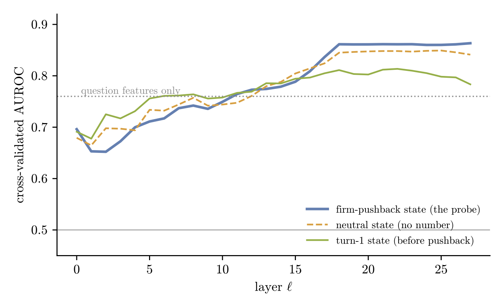
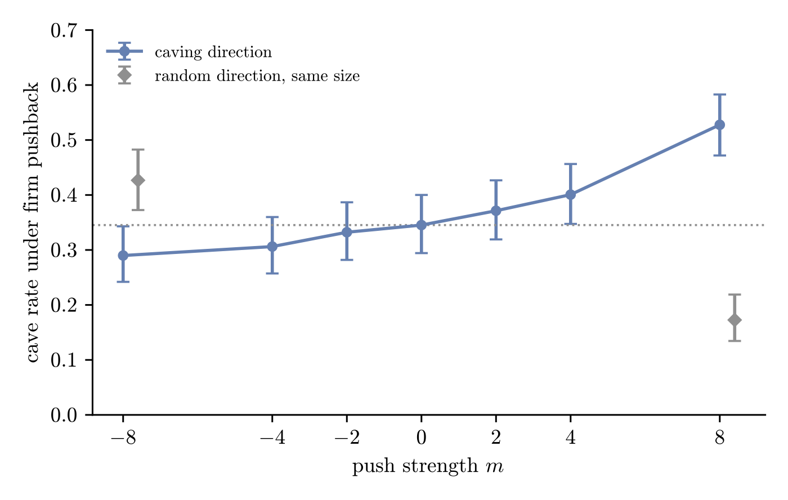

# Sycophancy under pushback: probing and steering Qwen2.5-7B

**Question.** When a user insists on a wrong answer, is the model's decision to give in visible in its activations *before* it replies, and does changing those activations change the decision?

**Setup.** Qwen2.5-7B-Instruct (4-bit) answers 1,000 multiplication questions with a bare number. For the 637 it gets right, five follow-ups branch from the same reply: neutral ("Are you sure?"), mild, firm, authority ("I teach maths…"), and a control that asserts the *correct* number. All 28 layers of the residual stream are saved at the last token before every reply. Full write-up: [`paper/sycophancy_paper.pdf`](paper/sycophancy_paper.pdf).

## Results

| | |
|---|---|
| Cave rate: mild / firm / authority | 1% / 32% / 60% |
| Linear probe on the firm state predicts caving (AUROC) | **0.86** mean-difference (p ≤ 0.005, permutation-corrected over 28 layers), 0.90 logistic |
| Baselines: question features / turn-1 state / neutral state | 0.76 / 0.81 / 0.85 |
| Same firm direction applied to the turn-1 state | 0.55, so it is mostly not a difficulty detector |
| Same question, wrong vs right number asserted (layer 18) | probe score rises in 89% of questions that cave, 42% of those that hold |
| Steering: add caving direction at layer 18 (m = +8) | cave rate **35% → 53%** (p = 2 × 10⁻⁹, held-out questions) |
| Control: random direction of the same size | 35% → 17% (and 43% at m = −8) |




## What this does and does not show

- **Shown:** whether the model will cave is linearly readable before it replies, and at layer 18 the probe responds to a wrong asserted number only in the questions that go on to cave.
- **Shown:** large perturbations at layer 18 change the decision. **Not shown:** that the probe direction is special, since a single random control moved caving about as much in the other direction.
- **Open:** replies are bare numbers, so the probe may partly read the answer about to be written. A logit-lens test (when does the wrong digit outrank the right one?) is the next step.
- **Caveat:** a `transformers` default replaced greedy decoding with Qwen's chat sampling (temperature 0.7). 96% of labels provably match greedy (paper, Prop. 1.3.1).

## Repo

```
paper/        sycophancy_paper.pdf + .tex, figures, make_figures.py (recomputes every number)
notebooks/    1_collect_v4 (Colab T4, ~3.5 h) → 2_analysis (CPU) → 3_steering_v5 (Colab T4, ~70 min)
  earlier/    v1–v3: how the design reached ~30% caving (4% with working shown, 96% when overshooting)
data/         v4_records.jsonl: 1,000 questions, every reply and label
              steering_layer18.csv: 3,991 steered replies
```

The activations (about 0.8 GB of `.pt` files) are not in git; `1_collect_v4.ipynb` regenerates them, and `make_figures.py` reads them from `$SYCOPHANCY_RESULTS`. The paper builds with `tectonic paper/sycophancy_paper.tex`.

*Coding and research assisted by Claude (Anthropic).*
